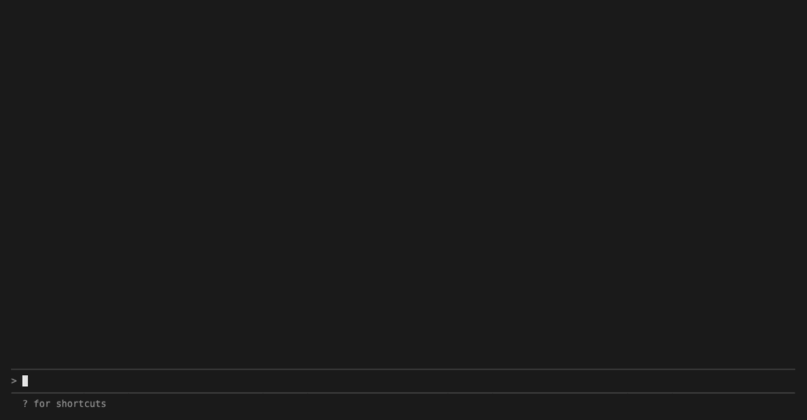

# claim

When an AI quotes a document, `claim` shows you the actual page with the quote
highlighted. It's one MCP tool that takes a file and a quote and returns a
picture: green if the whole quote is there, amber if only part of it is, and a
red bar with the page untouched if it couldn't find it. It reads PDFs, text and
markdown files, CSV/TSV/XLSX tables, images, web pages, and links to files. In
Claude Code it comes as a plugin that also scans every answer against the files
the session read: every run of eight words the answer shares with a file, and
every figure in it, is checked whether or not the model called the tool or used
quotation marks; a figure in no file is marked "in no file". The point is to
make any citation checkable at a glance, without trusting the model's say-so.

## Install

You need [uv](https://docs.astral.sh/uv/). Then, for Claude Code:

```
claude plugin marketplace add alnaik/claim
claude plugin install claim@claim
```

The first call is slow while uv sets things up. Web pages also need a browser:
`uv run playwright install chromium`, once, in a clone or the installed folder.

To try it without any AI:

```
git clone https://github.com/alnaik/claim.git && cd claim && uv sync
uv run claim fixtures/report.pdf "operating margins to remain broadly stable" --page 2  # writes out.png
```

## Add it to Claude Code / Claude Desktop / Cursor

Claude Code: the plugin above is all you need; it brings the server, tells
Claude when to call it, and scans the answers. From a clone, `claude --plugin-dir .`
loads the same plugin.

Claude Desktop (`~/Library/Application Support/Claude/claude_desktop_config.json`)
and Cursor (`~/.cursor/mcp.json`) take this block, with the path to your clone:

```json
{
  "mcpServers": {
    "claim": {
      "command": "uv",
      "args": ["run", "--directory", "/path/to/claim", "claim-server"]
    }
  }
}
```

## Use it

Ask something like *"Read report.pdf and tell me what the board expects next
year, then show me the source."* The AI quotes the document, calls `claim`, and
gets this picture plus the line `exact · report.pdf · page 2 · 84e3e316` (the
end is the start of the file's fingerprint):



The card under the call, then the scan catching a figure that is in no file.

In Claude Code each answer gets one line per claim under it, in the answer's order: the dot, the claim in
Claude's words, and where it is; `auto` marks one claim checked by itself, not because Claude asked. The
first problem's card is open, and a click on a line opens or closes its card: the highlighted lines close
up, and `enlarge` opens the picture. The line above the prompt counts the answer's checks; a click on it or
`/claim` opens the pane, the same lines for every answer. `/claim path/to/file` adds a file to check
against. A claim call on a file the session opened runs without a permission prompt; any other asks.

## What it can't do yet

- A paraphrase with no eight words in common with the file produces nothing, by design: claim checks literally and never guesses.
- Web pages are loaded by a headless browser, so pages that need a login or block bots won't work.
- No OCR: scanned PDFs come back "not found", and images come back "not searchable".
- A quote that runs across a page break is shown as a partial match from one page.
- Spreadsheets: `.xlsx`, `.xlsm` and `.xls` work, `.ods` and Numbers don't. Cells show the way Excel shows them for the common number and date codes, with the stored value under them; other codes, `.xls` and CSV show the stored value; Excel's default date follows this computer's date order. A formula cell shows its saved result, or the formula itself when a script wrote the file without one; claim never works a sum out.
- Word, PowerPoint and other office files aren't read yet, nor pasted images with no file. Files opened through a shell command are tracked by their names in the command.
- Cards show pictures only in terminals that draw images (Ghostty, Kitty, WezTerm); elsewhere a PDF card shows the status line, and `enlarge` opens the picture. The desktop app and VS Code may show a large crop's path. Claude Desktop and Cursor get the tool's image only, no band, pane or scan.
